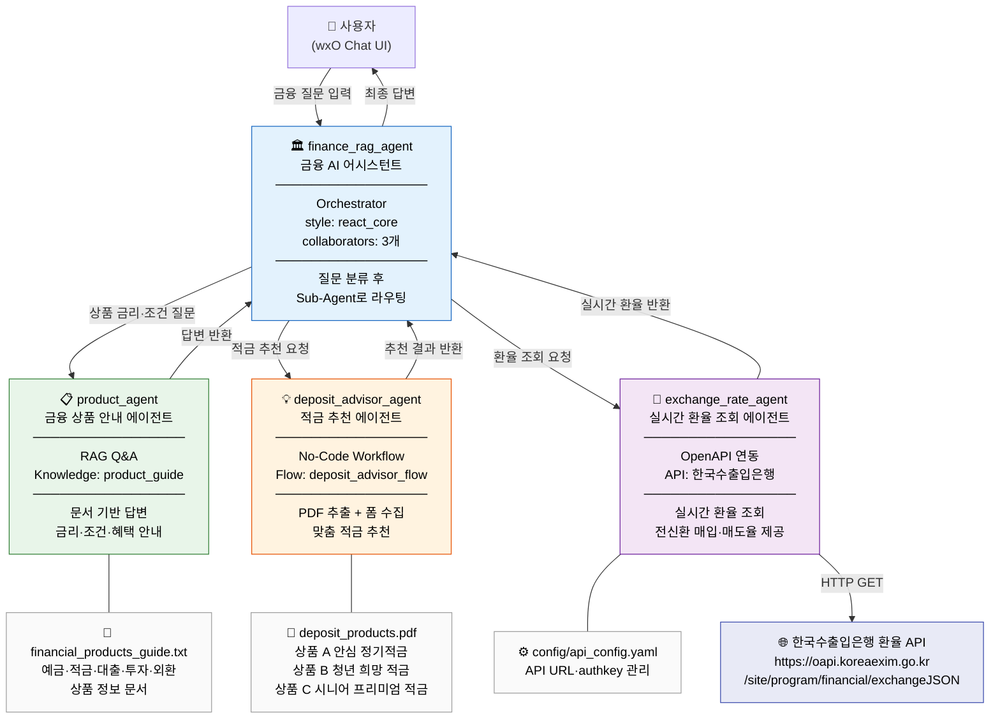
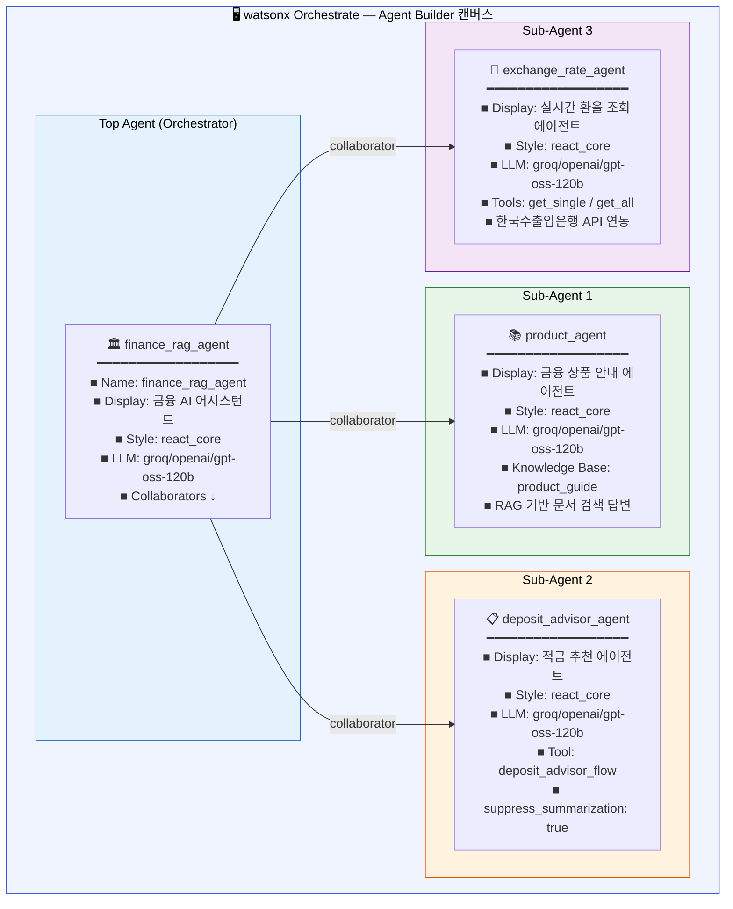
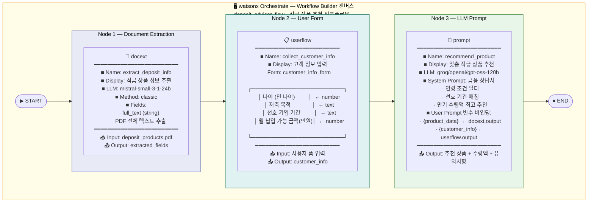
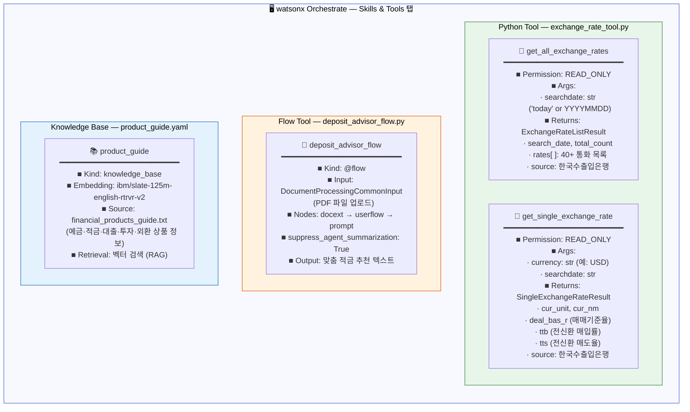
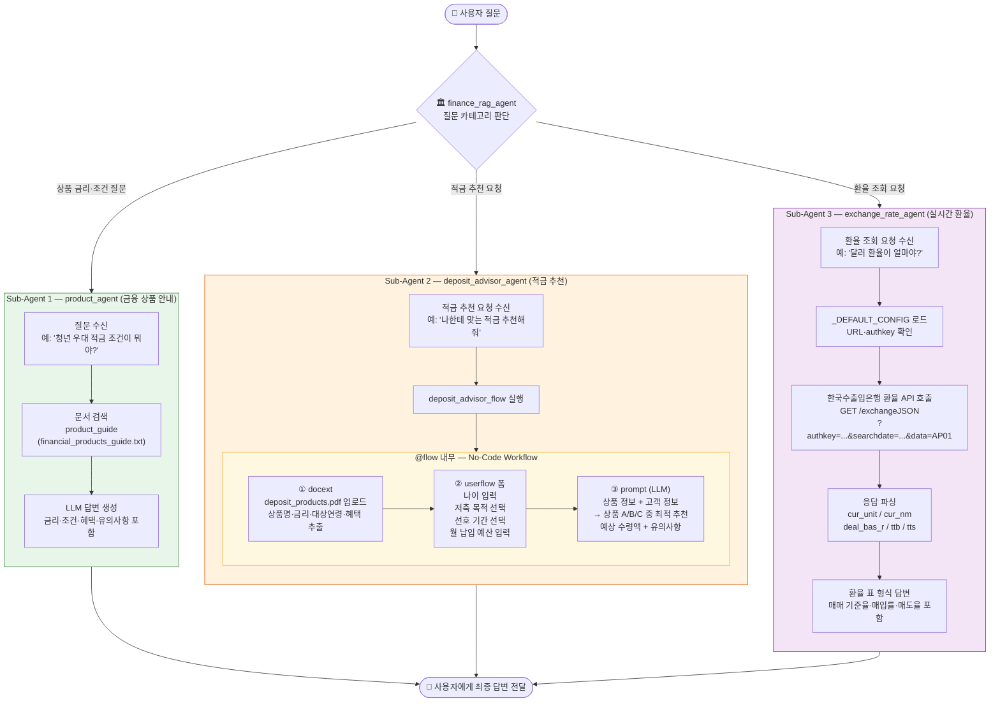
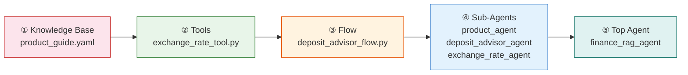

# Finance RAG Agent — Architecture

금융 산업을 위한 **watsonx Orchestrate No-Code 기반 멀티 에이전트 시스템**입니다.  
Top Agent가 사용자 질문을 분류하여 3개의 전문 Sub-Agent로 라우팅합니다.

---

## 1. 전체 시스템 아키텍처



---

## 2. wxO No-Code 빌더 UI — 전체 에이전트 연결 뷰

> wxO Agent Builder 화면에서 바라본 에이전트 연결 구조입니다.
> 각 박스는 wxO UI의 **에이전트 카드** 한 장에 대응합니다.



---

## 3. wxO No-Code 빌더 UI — deposit_advisor_flow 워크플로우 캔버스

> wxO Workflow Builder 화면에서 바라본 `deposit_advisor_flow`의 노드 배치입니다.
> 각 박스는 워크플로우 캔버스의 **노드 카드** 하나에 대응합니다.



---

## 4. wxO No-Code 빌더 UI — Tool Import 뷰

> wxO **Skills & Tools** 탭에서 바라본 임포트된 도구 목록입니다.



---

## 5. 전체 워크플로우 다이어그램 (사용자 시점)



---

## 6. 임포트 순서 (wxO CLI)



```bash
# 임포트 실행
source venv/bin/activate
orchestrate env activate wxO-apac --api-key "$IBM_CLOUD_API_KEY"
chmod +x scripts/import-all.sh && ./scripts/import-all.sh
```

---

## 7. Sub-Agent 상세 설명

### Sub-Agent 1 — `product_agent` (금융 상품 안내 에이전트)

| 항목 | 내용 |
|------|------|
| **역할** | 금융 상품 문서를 기반으로 고객의 질문에 답변하는 RAG 에이전트 |
| **방식** | Native Agent + 문서 검색 (No-Code) |
| **지식 소스** | `financial_products_guide.txt` — 예금·적금·대출·투자·외환 상품 정보 |
| **대표 질문** | "청년 우대 적금 가입 조건이 뭐야?", "주택담보대출 한도가 얼마야?" |
| **답변 방식** | 문서에서 관련 정보 검색 → 금리·조건·혜택·유의사항 구조화 답변 |

---

### Sub-Agent 2 — `deposit_advisor_agent` (적금 추천 에이전트)

| 항목 | 내용 |
|------|------|
| **역할** | PDF 문서에서 상품 정보를 추출하고, 고객 정보를 수집해 맞춤 적금 추천 |
| **방식** | Native Agent + `@flow` (No-Code Workflow) |
| **Flow 구성** | `docext` → `userflow` 폼 → `prompt` (LLM 추천) |
| **데이터 소스** | `deposit_products.pdf` — 상품 A / B / C |
| **대표 질문** | "어떤 적금이 좋을까?", "나한테 맞는 적금 추천해줘" |

**deposit_products.pdf 상품 구성:**

| 상품 | 대상 | 최대 금리 | 특징 |
|------|------|---------|------|
| 상품 A — 안심 정기적금 | 만 18세 이상 전체 | 연 3.8% | 기본형, 정기납입 |
| 상품 B — 청년 희망 적금 | 만 19~34세 | 연 5.0% | 비과세 + 저축 장려금 |
| 상품 C — 시니어 프리미엄 적금 | 만 55세 이상 | 연 5.0% | 건강검진 바우처 |

---

### Sub-Agent 3 — `exchange_rate_agent` (실시간 환율 조회 에이전트)

| 항목 | 내용 |
|------|------|
| **역할** | 한국수출입은행 환율 API를 통해 실시간 환율 정보 제공 |
| **방식** | Native Agent + OpenAPI `@tool` |
| **API** | `https://oapi.koreaexim.go.kr/site/program/financial/exchangeJSON` |
| **파라미터** | `authkey`, `searchdate` (YYYYMMDD), `data=AP01` |
| **설정 관리** | `_DEFAULT_CONFIG` 상수 내장 (서버 환경 fallback) |
| **도구** | `get_single_exchange_rate` (단일 통화), `get_all_exchange_rates` (전체 통화) |
| **대표 질문** | "달러 환율이 얼마야?", "달러·유로·엔화 환율을 한번에 알려줘" |

**API 응답 주요 필드:**

| 필드 | 설명 | 예시 |
|------|------|------|
| `cur_unit` | 통화 코드 | `USD`, `JPY(100)` |
| `cur_nm` | 통화명 (한국어) | `미국 달러` |
| `deal_bas_r` | 매매 기준율 | `1,331.50` |
| `ttb` | 전신환 매입률 (은행 매입가) | `1,317.96` |
| `tts` | 전신환 매도율 (은행 매도가) | `1,345.04` |

---

## 8. 파일 구조

```
banking/
├── ARCHITECTURE.md                      이 문서
│
├── index.html                           금융 홈화면 + wxO embedded agent
│
├── agents/
│   ├── finance_rag_agent.yaml           Top Agent (Orchestrator)
│   ├── product_agent.yaml               Sub-Agent 1 — 상품 안내
│   ├── deposit_advisor_agent.yaml       Sub-Agent 2 — 적금 추천
│   └── exchange_rate_agent.yaml         Sub-Agent 3 — 환율 조회
│
├── knowledge-bases/
│   ├── product_guide.yaml               Sub-Agent 1용 문서 검색 정의
│   ├── financial_products_guide.txt     금융 상품 안내 문서
│   └── deposit_products.pdf             적금 상품 A/B/C 안내 PDF
│
├── tools/
│   ├── deposit_advisor_flow.py          Sub-Agent 2용 @flow
│   └── exchange_rate_tool.py            Sub-Agent 3용 @tool (한국수출입은행 API)
│
├── config/
│   └── api_config.yaml                  API URL·authkey 관리 (⚠️ .gitignore 권장)
│
└── scripts/
    ├── import-all.sh                    전체 임포트 (KB→Tools→Flow→Agents)
    └── delete-all.sh                    전체 삭제 (역순)
```

---

## 9. 테스트 시나리오

| 시나리오 | 입력 예시 | 처리 경로 |
|---------|---------|---------|
| 상품 조건 질문 | "청년 우대 적금 가입 조건이 뭐야?" | Top → product_agent → 문서 검색 → 답변 |
| 대출 한도 질문 | "신용대출 한도가 얼마야?" | Top → product_agent → 문서 검색 → 답변 |
| 적금 추천 요청 | "나한테 맞는 적금 추천해줘." | Top → deposit_advisor_agent → Flow(PDF 추출+폼) → LLM 추천 |
| 환율 단일 조회 | "지금 달러 환율이 얼마야?" | Top → exchange_rate_agent → 한국수출입은행 API → 실시간 환율 |
| 환율 다중 조회 | "달러, 유로, 엔화 환율 한번에 알려줘." | Top → exchange_rate_agent → API → 표 형식 답변 |
